# ClawdIcons

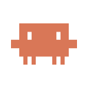

A pixel-art icon set featuring the Claude Code mascot in various actions, states, and life scenarios.

All icons are built on the same base mascot from [Claude Code](https://docs.anthropic.com/en/docs/claude-code), with contextual indicators for different situations.

## Preview

Open `icons/preview.html` in a browser to see all icons, or check the grid below:

### Tools (10)

| | | | | |
|:---:|:---:|:---:|:---:|:---:|
| 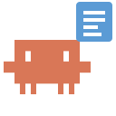 | 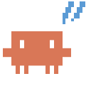 | 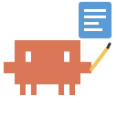 | 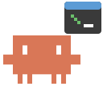 | 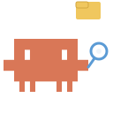 |
| Read | Edit | Write | Bash | Glob |
| 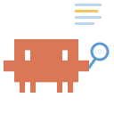 | 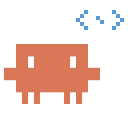 | 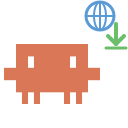 | 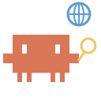 | 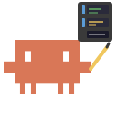 |
| Grep | LSP | WebFetch | WebSearch | Notebook |

### Dev Actions (21)

| | | | | |
|:---:|:---:|:---:|:---:|:---:|
| 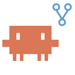 | 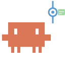 | 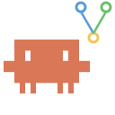 | 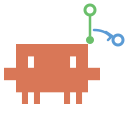 | 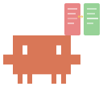 |
| Git | Commit | Merge | PR | Diff |
|  | 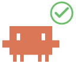 | 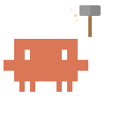 | 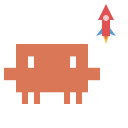 | 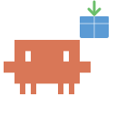 |
| Debug | Test | Build | Deploy | Install |
| 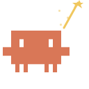 | 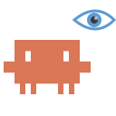 | 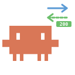 | 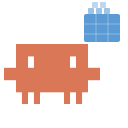 | 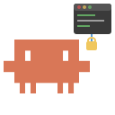 |
| Lint | Review | HTTP | Docker | SSH |
| 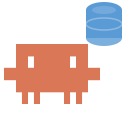 | 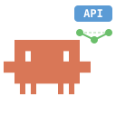 | 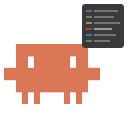 | 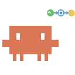 | 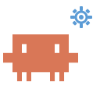 |
| Database | API | Logs | CI/CD | Config |
| 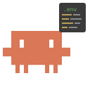 | | | | |
| Env Vars | | | | |

### States (12)

| | | | | |
|:---:|:---:|:---:|:---:|:---:|
| 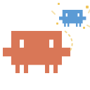 | 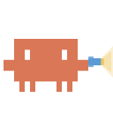 | 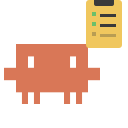 | 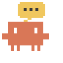 | 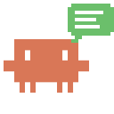 |
| Agent | Explore | Plan | Think | Answer |
| 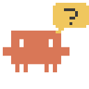 | 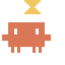 | 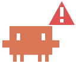 |  | 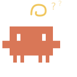 |
| Ask | Wait | Error | Success | Confused |
| 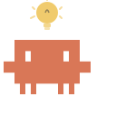 | 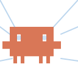 | | | |
| Eureka | Focus | | | |

### Life (22)

| | | | | |
|:---:|:---:|:---:|:---:|:---:|
| 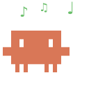 | 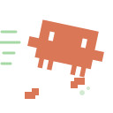 | 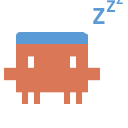 | 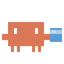 | 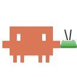 |
| Rest | Run | Sleep | Drink | Eat |
| 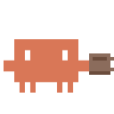 | 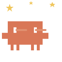 | 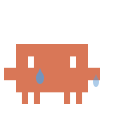 |  |  |
| Coffee | Happy | Sad | Music | Game |
|  |  |  |  |  |
| Book | Wave | Meditate | Rain | Love |
|  |  |  |  |  |
| Workout | Cook | Travel | Photo | Dance |
|  |  | | | |
| Pet | Birthday | | | |

## Usage

Each icon is a standalone SVG file (128x128 viewBox). Use them directly:

```html

```

## Regenerate

All icons are generated from a single Python script:

```bash
python3 generate_icons.py
```

## Structure

```
clawdary/
  clawd.svg              # Base mascot SVG
  generate_icons.py      # Icon generator script
  icons/
    clawd_*.svg          # 65 icon SVGs
    preview.html         # Visual preview page
```

## License

MIT
