# botpixels

Pixel pose kits for the AI agents that show up in our videos. Forked from
[wangzhaode/clawdicons](https://github.com/wangzhaode/clawdicons) (MIT), which draws Clawd, the
Claude Code mascot, in 65 poses. botpixels keeps Clawd exactly as upstream draws him and adds four
more characters in the same 65 poses.

| | Character | Inspired by |
|:---:|---|---|
|  | Clawd | Claude Code (upstream, unchanged) |
|  | Grok Bot ghost | xAI's Grok Bot |
| 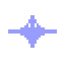 | Gemini sparkle | Google Gemini |
| 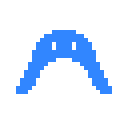 | Antigravity arch | Google Antigravity |
| 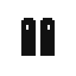 | ElevenLabs bars | ElevenLabs |

| Pose | Clawd | Grok Bot | Gemini | Antigravity | ElevenLabs |
|---|:---:|:---:|:---:|:---:|:---:|
| think |  | 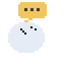 | 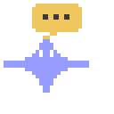 | 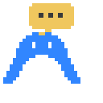 | 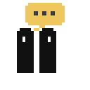 |
| bash |  | 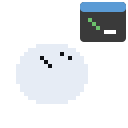 | 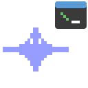 | 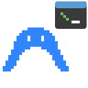 | 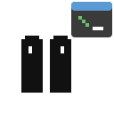 |
| coffee |  |  | 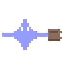 | 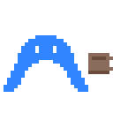 | 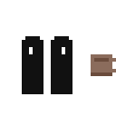 |
| sleep |  | 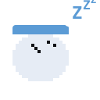 | 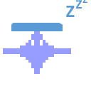 | 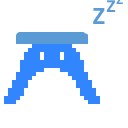 | 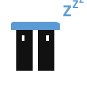 |

## 1. What it is and why

Our short videos cameo Clawd in a pose that matches the moment: thinking, running a command, drinking
coffee. Other agents appear in the same videos, but had no poses of their own. botpixels gives each one
the full set, in the same 128 by 128 SVG format, so anything that already places a Clawd pose can place
these too.

## 2. Constraints

- **These are not the companies' logos.** Each character is an original pixel drawing in the brand's
  colours. xAI and Google both forbid altering their marks, so no official artwork is traced or used.
  If you need the real logo, use the owner's unaltered file as a badge.
- No affiliation with or endorsement by Anthropic, xAI, Google or ElevenLabs is implied.
- Clawd's output must stay byte-identical to upstream commit `cb073fb`. A test enforces it.
- Python standard library only.

## 3. Setup

Python 3.10 or newer. Nothing to install.

```sh
git clone https://github.com/tedico/botpixels.git
cd botpixels
```

## 4. Usage

Regenerate every kit (safe to run from any directory):

```sh
python3 generate_icons.py
```

Run the tests:

```sh
python3 -m unittest -v
```

Use a pose directly:

```html

```

Open `kits/<id>/preview.html` in a browser to see all 65 poses of one character.

### Using the poses in your videos

**Get the files.** Download `botpixels-v1.0.0-svg.zip` from the
[latest release](https://github.com/tedico/botpixels/releases/latest). It has one folder per
character with all 65 poses, a base icon and a `preview.html` page. Open the preview first to pick
poses.

**Pick a pose for the moment.** Match the pose to what the voice is saying: `think` while a question
lands, `bash` or `write` while something gets built, `success` or `eureka` on the payoff, `wave` to say
hello or goodbye. Short cameos of one to two seconds read best, in empty space, never over your text
or captions.

**Drop them into your tool.**

| Tool | How |
|---|---|
| Web, HTML and CSS, or code-based video (Remotion, HyperFrames) | Use the SVG directly. Add `image-rendering: pixelated` and scale by whole numbers (2x, 3x, 4x) so the pixels stay sharp. |
| Canva, Figma, Keynote | Import the SVG as an image. It stays sharp at any size. |
| Video editors that want PNG (CapCut, Premiere, Descript) | Convert first: import the SVG into Figma or Canva and export PNG at 4x (512 px). Whole-number sizes keep the pixels sharp. |

**Avoid ImageMagick for conversion.** Its built-in SVG renderer draws these characters black and
striped. Browsers and Chromium-based tools render them correctly; check one export before batch
converting in any other tool.

**Animate the whole character.** The poses are still frames. Let your tool supply the motion: hop,
slide in from an edge, tilt, bounce, pop in and out. Avoid stretching one axis, which breaks the pixel
grid.

**Keep it honest.** These are original pixel characters, not the companies' logos. If your video is
about one of these products, say "not affiliated" in your caption, and never present a character as
the company's official mascot.

## 5. How it works

Upstream builds each Clawd pose as one body path plus an overlay of props. botpixels leaves that code
alone and derives the other characters from Clawd's finished SVGs:

1. Each character is a 24-wide pixel grid in `botpixels/mascots.py`. `#` is body, `o` is an eye, `.`
   is empty. Grids sit on Clawd's feet line, so hats and badges land where the overlays expect.
2. `botpixels/grid.py` turns the grid into SVG path data, one run per row.
3. `botpixels/derive.py` swaps Clawd's body for the character's, drops Clawd's orange arms and legs in
   the dance, run and wave poses, and recolours any other Clawd orange.
4. Poses where Clawd holds a prop in his right hand shift the prop group left so it meets the narrower
   body. The shifts live in the same table as the grids.

Output:

```
icons/                 Clawd, unchanged from upstream (65 poses, clawd.svg, preview.html)
kits/<id>/             <id>_<pose>.svg x 65, <id>.svg base icon, preview.html
```

## 6. Configuration

Everything is in `botpixels/mascots.py`. To add a character, add a `Mascot` with an id, title, grid,
body colour, and eye colour (or `None` for eyes cut out as holes). To move a prop for one pose, add
`"pose": (dx, dy)` to its nudges.

## 7. Troubleshooting

- **`error: <id>: row N ...`** The grid for that character is malformed. Every row must be exactly 24
  characters of `#`, `o` and `.`, with no trailing spaces, and at most 16 rows.
- **A character renders black or striped in ImageMagick.** ImageMagick's built-in SVG renderer
  mishandles these paths. Browsers, Quick Look and Chromium render them correctly.
- **The Clawd byte-identity test fails.** Something changed upstream's pose code or its output. Revert
  that change; Clawd's files are the regression baseline.

## 8. Legend

| Term | Meaning |
|---|---|
| Pose | One 128 by 128 SVG: a character plus a prop overlay |
| Kit | One character's 65 poses, base icon and preview page |
| Overlay | The props drawn on top of the body, shared by every character |
| Nudge | A per-pose shift of the overlay for one character |

## Credits and license

Poses and generator by [wangzhaode/clawdicons](https://github.com/wangzhaode/clawdicons), MIT. Character
grids and derivation by Ted Sandico, MIT. See `LICENSE`.
